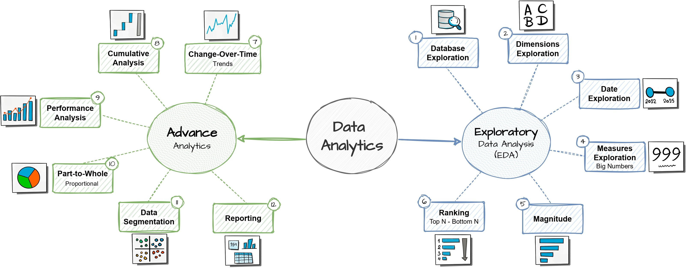

# SQL Data Analytics Project

```
sql-data-analytics-project/
├── 00_setup/                        the setup guide, and the one-click Docker start for Mac
├── 01_datasets/                     the data, as a backup and as CSV files
│   ├── DataWarehouseAnalytics.bak   the database, ready to restore
│   └── csv-files/                   the same data, to build the database yourself
├── 02_docs/                         the project roadmap and notes
└── 03_scripts/                      the queries, in the order of the videos
    └── 00_init_database.sql         builds the database from the CSV files
```

---

## 🗺️ What you build



The project has two parts, and the scripts follow them:

- **Exploratory data analysis**, scripts `01` to `06`: you get to know the data, from the tables and dates to the big numbers and the top performers.
- **Advanced analytics**, scripts `07` to `13`: you go deeper with trends, running totals, performance, part-to-whole and segments. Two reports close the project, one for customers and one for products.

---


## 🌟 About me

Hi, I'm **Rachel**, building projects in data analytics and data engineering.

